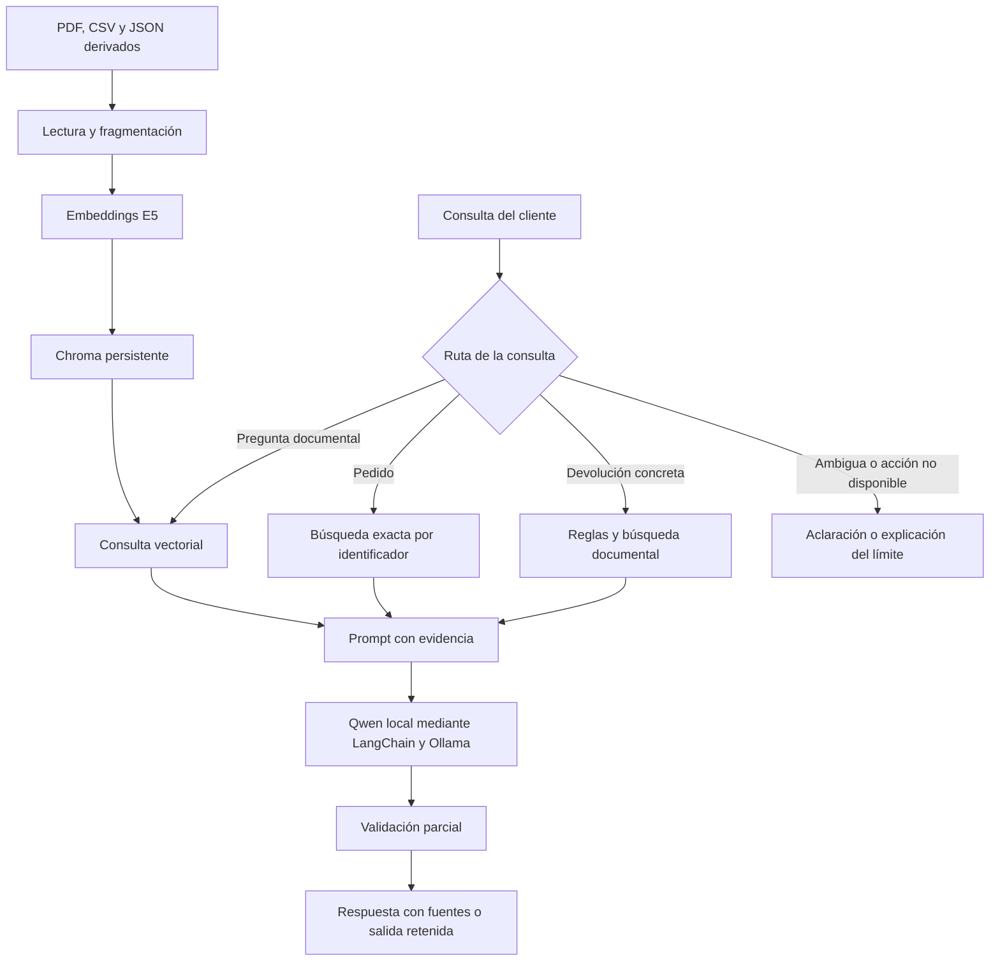

# Fase 1 - Por qué elegimos estos componentes

## Partimos del trabajo anterior

El [Taller 1](https://github.com/poppetmaster/iagen-taller1) usa Qwen2.5 7B con Ollama,
pedidos sintéticos, una política ficticia y reglas externas al modelo. Esa separación sigue
siendo útil: un estado de pedido debe buscarse por identificador y una devolución debe respetar
condiciones verificables. Aquí añadimos recuperación documental para preguntas que antes no
tenían un recorrido propio, como consultar el plazo general o la categoría de un producto.

Mantenemos el generador para observar el efecto de la recuperación sin cambiar también de modelo.
El modelo de embeddings tiene otra función: representa consultas y fragmentos para compararlos.
No redacta la respuesta ni decide si corresponde devolver dinero.

## Embeddings seleccionados

Elegimos `intfloat/multilingual-e5-small`, con revisión fija
`614241f622f53c4eeff9890bdc4f31cfecc418b3`. Su ficha declara cobertura multilingüe,
incluido español, vectores de 384 dimensiones y licencia MIT. La precisión sobre EcoMarket
debe comprobarse con sus preguntas; el soporte de un idioma no garantiza buenos resultados
en todos los dominios.

La implementación usa `SentenceTransformer` en CPU y normaliza los vectores. Añade `passage: `
a los documentos y `query: ` a las consultas, incluso en español, como indica la ficha.
Comprueba el máximo de 512 tokens para evitar truncar silenciosamente una condición relevante.

| Opción | Beneficio para el caso | Costo o límite | Decisión |
|---|---|---|---|
| E5 multilingüe pequeño, local | Modelo y revisión identificables; procesa consultas en español; no requiere enviar textos a una API de embeddings | Descarga, memoria, CPU y mantenimiento propios; precisión por evaluar | Elegido para esta entrega |
| Un E5 multilingüe de mayor tamaño | Candidato para una comparación si falla la recuperación | Mayor consumo; no hemos medido que mejore este caso | Alternativa posterior |
| Embeddings propietarios por API | El proveedor opera el modelo y facilita el servicio remoto | Tarifas vigentes, conectividad, condiciones de tratamiento de datos y dependencia del proveedor | Comparación de arquitectura; no implementada |

La opción local evita un cobro por solicitud al proveedor, pero no elimina energía, equipo,
almacenamiento ni trabajo técnico. No afirmamos que sea la más barata a cualquier escala.
Tampoco usamos una cifra de precisión de otro conjunto como si fuera un resultado de EcoMarket.

## Base vectorial seleccionada

Elegimos ChromaDB con almacenamiento persistente local e integración `langchain-chroma`.
Para unas decenas de fragmentos permite observar el índice, repetir las consultas y conservar
los datos sin contratar un servidor vectorial. Utilizamos distancia coseno: en el registro
mostramos `1 - distancia` como similitud, no como probabilidad de que la respuesta sea correcta.

| Alternativa | Ventaja | Desventaja y costo | Aplicación a EcoMarket |
|---|---|---|---|
| Chroma local | Instalación dentro del entorno Python y persistencia en una carpeta | El equipo asume operación, respaldos y recursos; el cliente local no demuestra alta disponibilidad | Adecuado para el alcance académico |
| Pinecone | Servicio administrado orientado a recuperación a escala | Requiere cuenta, conectividad y revisar tarifas y condiciones; dependencia de un proveedor | Candidato si se necesita un servicio administrado |
| Weaviate | Puede operarse por cuenta propia o mediante servicio administrado | El alojamiento propio exige operación; el administrado añade tarifas del servicio | Alternativa si se justifican sus opciones de despliegue |

No hicimos pruebas de carga con estas tres bases y no atribuimos diferencias cuantitativas
de velocidad o costo sin medirlas. Una decisión empresarial necesitaría volumen esperado,
concurrencia, disponibilidad, presupuesto y requisitos de datos.

## Cómo se conectan las piezas

LangChain organiza el prompt y la llamada al modelo. Chroma recupera documentos; E5 permite
compararlos con la consulta; Qwen redacta a partir de lo recibido. Ninguna de esas piezas
sustituye el motor de reglas ni garantiza por sí sola la veracidad del texto.

El notebook Plan-and-Execute de clase ayuda a reconocer herramientas y etapas. Su búsqueda
con Tavily no es la base interna requerida aquí. No incorporamos planificación iterativa
porque el recorrido de este taller puede expresarse con rutas y una cadena directa, con menos
llamadas y una explicación más sencilla de lo que ocurre.

## Cómo juzgamos la elección

Medimos si aparece evidencia pertinente entre los primeros cuatro fragmentos, si el modelo
respeta sus fuentes y si reconoce datos ausentes. El costo observado se limita a tiempos y
recursos locales; no calculamos ahorros empresariales. Los resultados y las limitaciones del
experimento están separados en [evaluacion/RESULTADOS.md](evaluacion/RESULTADOS.md).

Fuentes: [ficha de E5](https://huggingface.co/intfloat/multilingual-e5-small),
[Chroma](https://docs.trychroma.com/reference/python),
[Pinecone](https://docs.pinecone.io/guides/get-started/overview),
[Weaviate](https://docs.weaviate.io/deploy) e
[integración con Ollama](https://docs.langchain.com/oss/python/integrations/chat/ollama).
